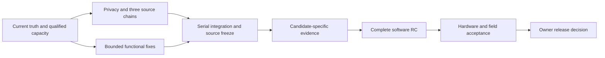

# Corrective execution plan from the comprehensive review — 2026-11-04

Source: [comprehensive review](../audits/COMPREHENSIVE_PROJECT_REVIEW_20261104.md) of `ac1dc745ebf552b4d762fc33bc25382052b0e9d6`.
Detailed actions, acceptance and every existing unit's feature/worktree/base/dependency reservation: [REMEDIATION_PLAN.json](comprehensive-review-20261104/REMEDIATION_PLAN.json). Exact committed-evidence snapshot: [REVIEW_BASELINE.json](comprehensive-review-20261104/REVIEW_BASELINE.json).

This is an actionable **coordinator proposal/crosswalk within the accepted P0–P5/OWNER program**, not a newly adopted phase decision or a launch receipt. Existing accepted packet `52ed758e711891ee57be0bbadb87c688333049733e697a52829cf0ba87d7b15e`, feature ownership, surviving acceptance and historical outcomes remain unchanged. New material contracts, strategy or author/reviewer-family changes require the actual prospective three-provider/three-round process before dependent execution. No such consensus is manufactured here; covered corrections retain normal qualification/review/launch gates.

## Order and exit conditions

| Stage | Work | Concrete exit |
| --- | --- | --- |
| **A0 — current truth and capacity** | CR-08/14: reconcile current status, classify 61 open records, select task-qualified author/reviewer pairs and correction reserve | Each ready task has a true residual scope, accepted dependencies, exact-base rule and verified route/capacity; material planning decisions have required actual coverage |
| **A1 — privacy and retained source review** | CR-04/05: finish `RV-PRIVACY-CHAIN`, `RV-WS040`, the remaining `RV-API034` report evaluation and preservation/admission dispositions | Full exact-commit different-family review for all three chains; no duplicate implementation; credential artifacts safe to admit |
| **A2 — bounded functional corrections** | CR-01/02/03 plus reproduced CR-09/10 defects: WebSocket work limits, HA credential validation, broken shortcuts, accessibility/support boundaries | Author fixes plus meaningful negative controls and qualified independent exact-commit review; unresolved historical hypotheses remain explicitly unproven |
| **A3 — compose and freeze** | Coordinator sequentially integrates accepted A1/A2 changes, resolving shared runner/model/evidence/API conflicts | One exact combined source candidate; source provenance and all relevant tests reviewed; shared contracts/registry/locks under coordinator ownership |
| **A4 — candidate-specific proof** | CR-06/07 and residual software-client contracts: eight security browser scenarios plus API controls, source/image/real-client coverage and privacy admission | Valid candidate ancestry, exact source/image/client binding, independent effect oracles, raw/combined summaries and no unexplained failures; every residual software-target/preparation obligation explicitly dispositioned |
| **A5 — software RC** | P4/P5 metadata/docs/build plus complete combined validation and independent output audit | Matching authorized version and amd64/arm64 artifacts; complete applicable core/Remote/HA/HACS/UI/source/image checks, 100% route coverage, schema/ledger/gate and exact remote/local checkpoint |
| **A6 — actual hardware and field** | Owner HIL-B/physical CEC/HIL-C/HIL-E, 72-hour soak and field week | Accepted immutable candidate, agreed actions, actual device effects, restored starting state, complete continuous measurements and owner observations/sign-off |
| **A7 — final release decision** | Final gate/evidence/finding/digest/version audit | Explicit owner authority before main merge, tag and final artifact release; no unresolved mandatory target or gate silently waived |

A1 and A2 can overlap only on exclusive paths with qualified review/correction coverage and actual available slots. Before each future wave: rediscover Run/host/catalog/fleet/inbox and protected resources, verify supported pool headroom, resolve the full base SHA and dependencies, then bind real Orca Task/Dispatch authority. Use at most two new workers plus coordinator and the protected external reservation; no nesting. Reserved names below do not create worktrees. Do not reserve the entire backlog against a current quota reading.

If A4 reveals a source defect, return that bounded correction to its author and exact changed-commit reviewer. Revalidate affected proof after covered files change, then run the final combined pipeline. Do not regenerate all security evidence between unfinished shared-tool edits, lower recorded targets or repeat an unchanged failed campaign.

## First source packages

1. **Privacy admission before evidence capture is accepted.** Review the complete retained `2d02004d` chain, preserving its real base and authorship. Cover recursive `X-Admin-PIN` request/action/procedure redaction, response/body/error paths, public fields and actual artifact writes. Reviewers report; authors correct.
2. **Bound WS `get_status`.** One leased implementation owner for dispatch and lifecycle changes. Test a pending refresh with burst frames, socket close and app shutdown, bounded tasks and continued service to another client. Preserve existing ping/status contract.
3. **HA credentials.** Real-HA setup/reconfigure/options tests must reject a wrong/missing/revoked key when control is locked, accept a valid key, and preserve offline-matrix/unlocked setup. Use existing nonmutating auth-status capability; handle its bare response shape correctly.
4. **UI shortcuts/accessibility.** Reproduce through actual browser interactions, wire the real settings controller and Profiles/Scenes view, then verify field suppression, focus/Escape, zoom and supported device sizes. Keep existing identifiers; only newly changed visuals need approval.
5. **Serial chain integration.** API-client C1 is already contained in C2, and privacy C1/C2 in C3. Review complete required boundaries, integrate three chains plus accepted new fixes, and resolve shared tool changes centrally. The bounded API review does not close security freshness or full P1.

These packages map to existing unit owners in the machine-readable plan; there is no second overlapping feature owner. Exact task/model/worktree matches must be revalidated. OpenAI source authors cannot review their own implementation through another OpenAI variant. Current scoped Opus eligibility cannot be promoted into broad security/privacy/UI/HA qualification by assertion.

## Evidence and compatibility work

- Preserve PR-merge CI as integration testing. The observed merge commit `c9dac37a` and branch `ac1dc745` have identical trees, but nonancestor merge records cannot simply become fresh branch proof. Run accepted canonical proof on the actual selected candidate ref with explicit source/image/client and ancestry binding; never edit record commit fields to make it fit.
- Reuse accepted, fresh, correctly attributed proof where its complete assertions survive. Inspect current CI originals before deciding a feature needs new implementation. The **89 software-target gaps** are not 89 proven bugs. Preserve and resolve the 56 historical CI attribution units separately from the newly inspected run.
- Test the exact HA 2025.1.0 floor and supported selected versions, plus declared Python 3.11 support, or reconcile those claims through a real compatibility decision. HACS custom-repository install/upgrade and a default-catalog listing are separate outcomes.
- Keep generated Flic JavaScript/SDK-request replay, real HA, scripted Remote, shipped-image tests and physical clients distinct. Prove denied/auth/recovery behavior and correlate actual requests/events with independent simulator or device effects.
- Do not close HIL-09's 12 caps without accepted real-device proof. Do not claim new capture repairs the lost original managed-failure bytes. Existing original Tron approvals and failed qualification attempts retain their actual provenance.

## Complete package coverage

The following crosswalk retains all **30 packages, 65 mapped units and 268 feature IDs**. Counts below are the read-only committed-evidence baseline, not estimates of missing code or accepted final client coverage. Cross-cutting packages own no additional feature IDs. Exact unit lists, original reservation/base rules and acceptance pointers are in [REMEDIATION_PLAN.json](comprehensive-review-20261104/REMEDIATION_PLAN.json); original contracts remain authoritative.

| Package | Phase | Units | Features | Below target |
| --- | --- | ---: | ---: | ---: |
| SW-AUDIT | P0 | 1 | 0 | 0 |
| SW-FINDINGS | P0 | 1 | 0 | 0 |
| SW-HARNESS | P0 | 1 | 0 | 0 |
| SW-API-READ | P1 | 4 | 10 | 0 |
| SW-SEC-AUTH | P1 | 3 | 8 | 6 |
| SW-API-WRITE | P1 | 4 | 20 | 13 |
| SW-SEC-DATA | P1 | 2 | 7 | 6 |
| SW-API-CLIENT | P1 | 2 | 12 | 11 |
| SW-DOM-PROFILE | P1 | 2 | 7 | 6 |
| SW-DOM-SCENE | P2 | 1 | 6 | 1 |
| SW-DOM-MACRO | P2 | 1 | 3 | 3 |
| SW-DOM-SHORTCUT | P2 | 2 | 8 | 3 |
| SW-DOM-PRESENT | P2 | 1 | 6 | 6 |
| SW-UI-CONTROL | P2 | 3 | 14 | 7 |
| SW-UI-MANAGE | P2 | 2 | 12 | 8 |
| SW-UI-PRESENT | P2 | 2 | 10 | 9 |
| SW-KIOSK-CONTROL | P2 | 2 | 7 | 4 |
| SW-KIOSK-STATE | P2 | 2 | 7 | 3 |
| SW-FLIC | P2 | 2 | 10 | 3 |
| SW-PROTOCOL-PREP | P3 | 7 | 42 | 42 |
| SW-RUNTIME-PREP | P3 | 7 | 37 | 37 |
| SW-UC-PREP | P3 | 3 | 17 | 17 |
| SW-HA-PREP | P3 | 3 | 18 | 18 |
| SW-DOM-HIL-PREP | P3 | 1 | 6 | 6 |
| SW-SOAK-PREP | P3 | 1 | 1 | 1 |
| SW-REPO | P4 | 1 | 0 | 0 |
| SW-DOCS | P4 | 1 | 0 | 0 |
| SW-VERSION | P4 | 1 | 0 | 0 |
| SW-BUILD | P4 | 1 | 0 | 0 |
| SW-SOFTWARE-GATE | P5 | 1 | 0 | 0 |

## Owner inputs and longer-term debt

No additional hardware or credential input is needed to fix the bounded software issues and prepare evidence. Later owner gates need: the physical matrix/firmware and attached devices, Remote/Flic/HA availability, deployment topology, backup/restoration and disruptive-action scope, supported physical viewport observations where unresolved, and an agreed continuous soak/field window. The remaining external cache-purge/support condition and final publication authority stay explicit owner actions. Do not send messages or change account scopes on the owner's behalf without authorization.

The 72-hour and week windows are real measurement requirements after a stable candidate; they may overlap only with owner-approved conditions and continuous identity/collection. No completion date is promised from feature or test counts.

Treat broad CSS/JS decomposition, removal of old parallel paths, suppression reduction and future aiohttp deprecation cleanup as separately justified debt after reproducing functional impact. Current passing lint baselines are not zero debt, and large files alone are not proof of a defect. Protect uncertain old workspaces until Orca recovery positively settles them; the completed 33-tree cleanup is historical, not a new cleanup task.
