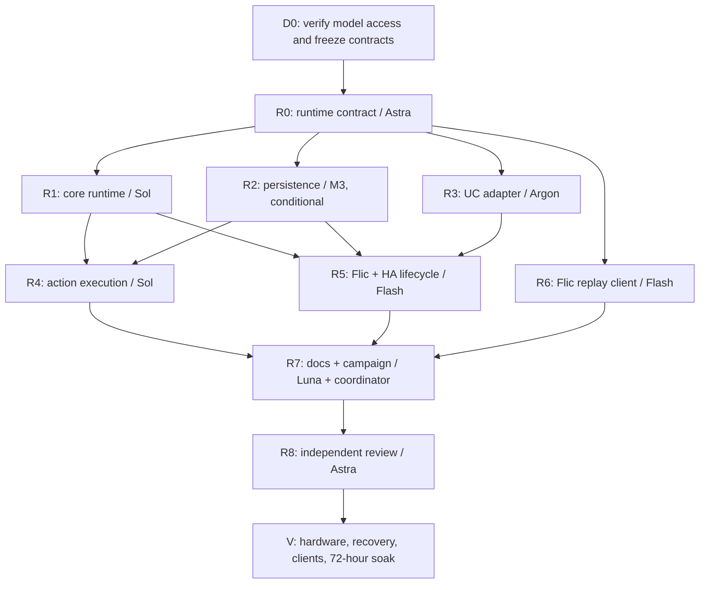

# Runtime completion and release plan

Status: executing. The runtime implementation and corrective tracks through
R1E, R5C and R6C are integrated. The clean `59aae63` local core run passed
3,941 tests with four documented skips and 177/177 routes; its source campaign
passed all 1,506 API/browser/Remote/Flic outcomes. At `a7eedf6`, corrected real
HA source campaigns passed 19/19 on both 2026.9.3 and the supported 2025.1 line
(tested at 2025.1.4). CI passed 3,934 core tests with 22 skips and 177/177 routes;
these are distinct environments and counts, not interchangeable results.
Argon owns R3E's bounded UI startup-ordering fix, informed by a separate read-only
Sol review. R7 Luna's guide preparation is accepted; final evidence indexing and
fresh Astra R8 review await the remaining image/client and UI validation.
See the [execution record](RUNTIME_EXECUTION.md). Updated 2026-10-19. This is the next execution
plan after the integrated Phase 6/7 work. It supplements the original Phase 8
validation gate rather than renumbering historical phases.

The owner's 2026-10-18 instruction supersedes the old mandatory six-model roster:
**no Claude or Anthropic models in these phases**, including reviewers, fallback
models, OpenCode helper agents and category routing. Balance assignments by task
risk and verified access; do not create six workers merely to fill six slots.
See the [model and agent inventory](MODEL_AND_AGENT_INVENTORY.md) for evidence,
exact IDs, access limitations and capability sources.

## What must be completed

At the start of this plan, the application constructed `OreiMatrix` and
`RestApiServer` directly or delegated to `src/driver.py`; the service, executor,
loader and migrations were separate frameworks. Shared composition, packaged
entrypoint, UC bridge and dedicated Flic replay are now accepted on the runtime
branch. Persistence, action parity and flag/lifecycle corrections have since
been accepted. The remaining software work is startup synchronization, fresh
image/client validation, evidence reconciliation and independent review. Physical
client, recovery, soak and owner acceptance gates follow those checks.

No work below approves the three pending Tron snapshots. PR #36 and PR #37
remain subject to their own CI and review gates. Their latest runs both fail
only those three snapshots; the other applicable checks pass. No release tags
have been pushed. The existing report remains evidence for the tested commit,
not proof for future runtime changes.

## Branches, ownership and sequence

Create a new integration branch `wp-runtime-completion` from the current,
clean Phase 6/7 integration tip when dispatch starts; record its exact SHA.
Do not base it on `main` while `main` lacks the candidate changes. Bring in
the approved Phase 5 changes and later merge commits in sequence. Keep runtime
completion in its own PR after PR #37, with the prerequisite clearly stated.
Planning changes do not themselves create a worktree or start an agent.

The coordinator remains **Sol 6.1 high** and owns merges, shared registry/schema
updates, release metadata, cross-track integration and evidence aggregation.
Workers must use their own Orca worktree, never change the coordinator checkout,
and never merge, tag, publish or update another worker's files.

Each arrow is an acceptance/merge dependency. R1, R2, R3 and R6 may run in
parallel after R0. R4 and R5 may run together after R1/R2/R3 are accepted.
R7 may prepare guides from accepted runtime behavior while the final correction
and campaigns run. Its evidence index and acceptance wait for the completed
campaign; R8 reviews the final integrated commit. Do not
start a dependent worktree on an obsolete base and hope to resolve it later.
Start with at most four workers, reduce concurrency when quota or Docker/CI
resources are constrained, and keep heavy campaigns serialized.

## Worktree assignments

These are task-fit judgments, informed by provider documentation and observed
project behavior; they are not a benchmark proving one provider beats another.
The model is an assignment, not evidence that a worker has already started.

| ID / Orca worktree | Model and agent | Why this assignment | Depends on |
| --- | --- | --- | --- |
| R0 `wp-runtime-contract` | Astra high, `codex` | Bounded architecture task: identify shared interfaces, compatibility and data-loss risks before concurrent edits | Access preflight |
| R1 `wp-runtime-core-composition` | Sol 6.1 high, `codex` | Main implementation model for startup, shared state, cancellation and one matrix connection | R0 |
| R2 `wp-runtime-persistence-wiring` | MiniMax M3, `opencode`, conditional on quota/model proof | Substantial but bounded migration/reader work with explicit fixtures; distributes implementation beyond OpenAI/Google | R0 |
| R3 `wp-runtime-uc-adapter` | Argon high, `antigravity` | Complex protocol integration and a second provider's reasoning over the runtime contract | R0 |
| R4 `wp-runtime-action-parity` | Sol 6.1 high, `codex` | Security-sensitive shared execution, partial results and compatibility across entry points | R1, R2; begin after R3 merge to share one base |
| R5 `wp-runtime-integration-lifecycle` | Flash 3.8 high, `antigravity` | Focused integration lifecycle and flag behavior under an already frozen contract | R1, R2, R3 |
| R6 `wp-validation-flic-replay` | Flash 3.8 high, `antigravity` | A bounded client implementation with exact request fixtures and simulator assertions | R0; integrated behavior checked again after R4/R5 |
| R7 `wp-runtime-guides-and-gate` | Luna medium, `codex` | Trace final behavior into guides and evidence indexes; coordinator owns running the release campaign | R2, R3, R4, R5, R6 |
| R8 `wp-runtime-independent-review` | Fresh Astra high, `codex` | Independent review of startup, data preservation, authorization, duplicate execution and shutdown | R7 and integrated campaign |

The intended implementation balance is two Sol tracks, one Argon track, two
Flash tracks, one M3 track and one Luna documentation track. Astra gets a short
design pass and a separate final review, rather than every implementation.
M3.1 Flash Preview and DeepSeek V4 Pro remain conditional alternatives described
in the inventory; they are not mislabeled as proven launches. If M3 is exhausted,
assign R2 to Argon high and record the change. If Google is constrained, Sol high
is the fallback for critical wiring and Luna high for bounded client/docs work.
No fallback may use Anthropic. Prefer a fresh reviewer who did not author the
implementation; unresolved critical review findings block acceptance.

Execution adjustment: M3 produced a committed R2 checkpoint but did not complete
the storage acceptance boundary. After its failed outcome and release, fresh
Sol 6.1 high took over the same worktree and Task. Sol also completed bounded
R1P installed-entry and R3B transaction corrections. These quality-driven
assignments are recorded in the execution record; the original model balance
does not override data-preservation or transaction requirements.

## Worktree briefs and acceptance

### R0: freeze the contract

Own `docs/planning/RUNTIME_CONTRACT.md` only. Inspect actual code and tests before
specifying constructor/factory signatures for the runtime composition, shared
`HubClient`, action execution, integration lifecycle and migration boundary.
Record exact file ownership for the following workers before dispatch.

Resolve the existing Flic default conflict (loader is opt-in; Flic config says
default enabled), matrix address precedence with UC setup, handler dependencies,
event subscriptions and shutdown order. Preserve established unset-variable
behavior until an explicit compatibility decision is recorded. Do not invent a
new API or choose a breaking response format under the label of refactoring.
The coordinator reviews the contract and incorporates concrete follow-up work;
R0 does not claim implementation complete.

### R1: compose the real runtime

Own `run.py`, new `src/hub/runtime/` composition modules, runtime injection in
`src/rest_api/app.py`, and dedicated runtime tests. R0 must identify any extra
REST state-access seam (such as `src/rest_api/utils.py`) before dispatch.
Do not modify integration implementations or persistence readers in parallel.
R5 may extend only the integration-wiring module after this track is accepted.

Instantiate one matrix client/service and one event bus for both startup modes;
inject shared clients/managers instead of creating another matrix connection.
Connect REST state and WebSocket events to the same service. Preserve health,
ports, saved Remote configuration, environment aliases and API authorization.
Test real startup through `run.py`, reconnect, partial startup failure, task
cancellation and shutdown; show no duplicate refresh tasks or event delivery.
Unit tests of an unreferenced factory are insufficient.

### R2: wire persistence safely

Own `src/hub/persistence/`, legacy persistence readers in `src/persistence.py`,
`src/config.py`, `src/scene_manager.py`, `src/cec_macros.py`,
`src/system_shortcuts.py`, `src/dashboard_layout.py`,
`src/rest_api/device_settings.py`, and migration fixtures/tests. Own only the
reader/serialization portions of these modules; the contract must identify
calls required by R1/R4. R5 owns any Flic-specific reader adaptation later.

Migrate before managers consume data. Cover legacy paths/filenames, backups,
atomic writes, restart idempotence, unknown keys, corrupt input, future schema
versions, and flat maps that must not treat `schema_version` as a record.
Run old-version fixtures through actual startup and each relevant manager;
assert retained profiles/scenes/macros/shortcuts/layout/settings, not just
successful migration function return values. No destructive automatic rollback.

### R3: finish the UC adapter

Own `src/hub/integrations/unfolded_circle/`, its adapter/factory boundary and
dedicated UC tests. Do not edit `run.py`, shared runtime modules or the legacy
driver concurrently; proposed legacy removal is a later coordinator decision.

Bind the modular integration to the shared `HubClient`; preserve approved
entity IDs and configuration, setup/reconfigure behavior, subscriptions, CEC
target capabilities, profile passcodes, standby and mDNS cleanup. Ensure it
conforms to the loader contract. Prove commands/readback in the scripted Remote
harness and failure/reconnect tests. Physical Remote verification stays V4.

### R4: unify execution without weakening contracts

Own `src/hub/domain/action_runner.py`, `src/hub/integrations/hub_client_local.py`,
action call sites in `src/rest_api/profiles.py`, `scenes.py`, `scenes_v2.py`,
`macros.py`, `system_shortcuts.py`, and dedicated action-parity tests.
R0 identifies preset and direct-command handler seams precisely before dispatch.
Do not take ownership of R2's manager serialization or R3's UC entity code.

Use one executor for profile/scene/macro/shortcut/preset actions while keeping
matrix-level protocol operations in their existing service. Prove REST and UC
share effects/results; verify passcode refusal, lockout, partial failure,
missing targets, cancellation and no duplicate commands. Preserve public status
codes and response bodies unless a contract change is explicitly documented.
Inventory every affected write route and refresh its validation registration.

### R5: honor integration flags and lifecycle

Own `src/hub/integrations/base.py`, `flic/`, `homeassistant/`, the integration
wiring module handed over by R1, and dedicated flag/lifecycle tests. Any change
to REST route mounting is now sequential to R1, under explicit coordinator
ownership transfer. Do not let both workers edit `src/rest_api/app.py` at once.

Mount enabled integrations once, honor explicit Flic disable, and start/stop HA
discovery only when configured. Disabled integrations must have no dependency
imports, listeners, subscriptions or discovery advertisements. Cover every flag
combination, startup rollback and reverse shutdown; retain manual HA setup.
Apply R0's explicit default/compatibility decision. Verify Flic's migrated
registry skips schema metadata. Add integration health to an existing surface
where possible; a new endpoint requires the registry/simulator/ledger rule.

### R6: implement the dedicated Flic replay client

Own new `tools/validate/clients/flic.py`, its registration in `__init__.py`, and
dedicated validation-client tests. Use the approved request shapes from the
current Flic setup/UI templates, including headers, body, click actions and
credential handling. Exercise those shapes against the shipped simulator-backed
hub image, assert resulting state and matrix commands, and cover failure/auth
paths. Unsupported scenarios must state why; do not return a blanket pass or
delegate everything to `ApiClient` and call it Flic proof. The coordinator owns
shared scenario registry/evidence changes. Replay is not physical button proof.

### R7/R8: reconcile and independently validate

R7 owns architecture/configuration/client guides and an evidence index for the
new commit, not the runtime implementation or a fabricated report. Keep earlier
candidate records attached to their actual commit. The coordinator runs the
full product suite, dedicated UC/HA/Docker jobs, applicable browser suite and
API/browser/UC/HA/Flic campaigns through the built image. Keep route coverage
at 100% of each configured route inventory; 177 is today's baseline, not a
permanent required route count when integrations are disabled.

R8 owns an audit report and reproductions in new review tests only. It must
inspect live startup and data migration, not just read green unit-test output.
Review auth boundaries, data loss, task leaks, duplicate execution, reconnect
and configuration changes. Findings go back to the responsible owner in a
fresh worktree, followed by targeted reruns and affected integration gates.

## Launch and model verification

Use the [inventory's launch recipes](MODEL_AND_AGENT_INVENTORY.md#launch-rules).
For each worktree, record task, exact model/agent/effort, base SHA, owned files,
dependencies, receipt/handle and a narrow acceptance command list in its brief.
Confirm the effective provider/model from the agent session before accepting
work. A requested label or successful terminal creation does not prove it.

Audit all automatic helper and fallback routes against the non-Anthropic
allowlist before using a multi-model harness. If the effective model cannot be
established, mark the assignment unverified and use a confirmed alternative.
Inspect worktree setup hooks and default agent tabs as well: explicitly choosing
one worker must not implicitly start an excluded agent alongside it. Use a
supported per-worktree configuration; do not change global defaults or launch
an excluded agent first and attempt to stop it afterward.
Do not silently relabel M3 as M3.1, spend paid credits to test catalog-only
providers, or change global account/model settings as part of this plan.

Every accepted worker must supply its commit, actual files, tests and remaining
limitations. The coordinator runs targeted checks, reviews, merges and promptly
removes the settled Orca worktree with `orca worktree rm`, then prunes Git
worktrees. Never delete an unmerged branch just to make cleanup look complete.

When REST routes change: update `docs/validation/features.yaml`, add/update
`tests/sim/test_sim_rest_reads.py`, and run `python -m tools.validate ledger`.
The coordinator serializes shared registry/ledger/OpenAPI edits to avoid races.
Never regenerate shared artifacts while a suite is checking their old state.

## Final validation and release gates

After runtime completion passes its software gates, refresh evidence for that
exact candidate and run the existing Phase 8 / WP-V3 campaign. No model can
substitute for owner-observed matrix/CEC effects, deployment outage/recovery,
physical Remote 3/client behavior, or the 72-hour soak and field sign-off.
Prepare a reproducible runbook and metrics collection; report gaps as pending.

Release order remains: approve/fix Phase 5 visuals, green CI and PR #36 merge,
`v0.5.0`; PR #37 merge and the RC tag when its gates pass; runtime-completion PR
and a fresh candidate before the final hardware campaign. If RC1 was already
published before runtime completion, use RC2 for the changed runtime; never move
an existing tag. Do not tag final `v1.0.0` while these requirements are open.
Before final publication, synchronize the canonical version to `1.0.0`, rebuild
and verify its matching tag/image metadata, and refresh affected evidence under
the validation plan's freshness rules. A final tag must not ship RC metadata.

The three pending Tron baseline updates are a separate owner decision under
[the review rule](../REMEDIATION_PLAN.md) §5.3 and Phase 5; new work does not
provide that approval.
