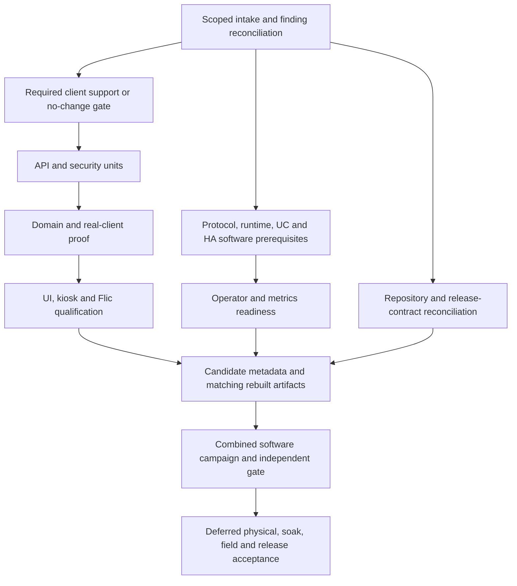

# Software release phases and Orca execution waves

Owner scope: build out and execute the remaining nonhardware development through
dedicated Orca worktrees, balancing task-relevant models across available
providers. Capacity affects routing and packing, not whether development continues.
This plan continues EV-02/EV-03 and software preparation for EV-04/EV-05. It does
not restart the accepted R0–R8 campaign or authorize physical testing, new visual
approvals, main merges, tags or release publication.

Read [package briefs](software-waves/PACKAGES.md),
[dispatch/review templates](software-waves/TASK_TEMPLATES.md) and the
[complete allocation manifest](software-waves/manifest.json). The manifest is
static planning data, not a launcher, evidence record or Orca authority.
Live assignments and observations belong in the
[allocation ledger](../production/AGENT_ALLOCATION.md).

## Baseline and complete scope

Inventory base: `97e617c2276c7b1e015bb4a9419cb9820deafdee`, published on
`wp-runtime-completion`; CI
[39374096223](https://github.com/ryan-haver/8x8-hdmi-matrix-hub/actions/runs/39374096223)
passed all 13 required checks. The actual merge `93630762` has the identical
tree. Source/API/browser/UC outcomes were 1,414/54/18, actual HA client 19,
core 4,023 passed/22 skipped/35 deselected with 177/177 REST routes, and UI
1,101 passed/33 skipped. This is a dated baseline, not fresh qualification of
future commits. The three approved Tron frames passed; further visual changes
still need their own owner decisions.

| Inventory | Count | Work allocated here |
| --- | ---: | --- |
| Software targets V2/V3 | 147 | Full feature-specific qualification, including adequate assertions, real clients, fresh evidence and necessary defect correction |
| Below software target | 84 | Subset of the 147; remaining qualification gaps, not 84 assumed defects |
| Numerically at software target | 63 | Subset of the 147; preserve accepted scope and reconcile fresh proof/regressions |
| Physical targets V4 | 120 | Software prerequisites, simulator/capture/SDK/container validation and exact owner handoff only |
| Field target V5 | 1 | Existing collector/analysis/runbook readiness only; actual 72 hours and week sign-off deferred |
| Parser-open findings | 59 | Every finding has a primary reconciliation owner; stale row text is not proof of a current defect |

All 268 features have exactly one primary package and bounded unit in the
manifest. The canonical ledger snapshot has 205 below target and 57 stale;
its generator header is `3539b190`, inspected at the inventory base. No ledger
was regenerated or feature level changed to create this plan. Source-file
hashes and actual `Scenario.features_for(client)` declarations are retained in
the manifest; declared mappings still require assertion/client-capability review.
The seven accepted EV-02 API dispositions retain their original evidence and
are regression/preservation work, not new implementation by default.

## Phases and suggested wave packing

There are **30 packages and 65 bounded units** after two scoped splits on 2026-10-20. The original published allocation had 63 units. A unit has at most six primary
features; cross-cutting units have an explicit scope instead. Each has unique
new test/report/artifact paths. A package may take several small dispatch
batches. The wave number is suggested packing, not a dependency on every earlier
wave. Use the manifest DAG to pull any ready independent unit forward.
Dependencies within a suggested wave run serially, never simultaneously.

| Phase | Wave | Packages | Exit condition |
| --- | --- | --- | --- |
| P0: source truth and scoped contracts | W00 | SW-AUDIT + SW-FINDINGS | Per-feature and finding dispositions, bounded corrective scopes, client-support requirements |
| P0: minimal shared support | W01 | SW-HARNESS | Only required support changed and cross-family reviewed, or an inspected no-change gate |
| P1: API and security | W02 | SW-API-READ + SW-SEC-AUTH | Root/configuration/WS foundations and actual auth/client guard behavior |
| P1: API and security | W03 | SW-API-WRITE + SW-SEC-DATA | Complete grouped mutation/refusal contracts, storage/rendering/TLS/no-leak proof |
| P1: real-client attribution | W04 | SW-API-CLIENT + SW-DOM-PROFILE | V3 API effects and profile editing/capture/PIN/legacy proof |
| P2: domain workflows | W05 | SW-DOM-SCENE + SW-DOM-MACRO | Client editing, validation, dry-run, overrides/history and failure/cancel proof |
| P2: domain workflows | W06 | SW-DOM-SHORTCUT, then SW-DOM-PRESENT | Shortcut effects followed by persisted dashboard/metadata/preset/theme behavior |
| P2: main UI | W07 | SW-UI-CONTROL + SW-UI-MANAGE | Actual client controls, editors, onboarding and recovery, independent state/effects |
| P2: presentation and kiosk | W08 | SW-UI-PRESENT + SW-KIOSK-CONTROL | Accessibility/responsive controls and kiosk action proof; new visual differences held separately |
| P2: client completion | W09 | SW-KIOSK-STATE + SW-FLIC | Persisted kiosk behavior and SDK-stub/request Flic qualification with auth |
| P3: software prerequisites | W10 | SW-PROTOCOL-PREP + SW-RUNTIME-PREP | Preserved-capture/simulator and runtime/container prerequisites; hardware caps retained |
| P3: client prerequisites | W11 | SW-UC-PREP + SW-HA-PREP | Scripted Remote and real isolated HA behavior; owner device/LAN steps prepared |
| P3: operator readiness | W12 | SW-DOM-HIL-PREP + SW-SOAK-PREP | Exact physical-domain/restore and metrics/field handoff, without execution |
| P4: release preparation | W13 | SW-REPO + SW-DOCS | Finding/history/license/supply-chain reconciliation and accurate guides/claims |
| P4: candidate assembly | W14 | SW-VERSION, then SW-BUILD | Independently reviewed canonical metadata, matching fresh multi-arch artifacts/digests |
| P5: software acceptance | W15 | SW-SOFTWARE-GATE | Full combined campaign, per-feature acceptance, independent final audit and verified publication |

SW-PROTOCOL-PREP, SW-RUNTIME-PREP and SW-REPO are not forced to wait for W10/13;
their actual prerequisites may make them useful earlier work. Likewise Flic or
another client unit can move forward when its contracts are accepted. Global
inventory is not a blanket barrier: a coordinator can satisfy its bounded intake
and no-change harness check for a ready unit while the complete inventory runs.
The first F-API-002 unit uses existing HTTP/assertion support and follows this route.

## Provider balancing and concurrency

Use the minimum of actual runtime/host/provider limits and the project ceiling
of **four active agents including the coordinator**. Count retained live or
unverifiable processes conservatively; historical Task rows are not each an
additional agent. A provider account pool may also have other projects consuming
it. Do not confuse filesystem worktrees with active agent capacity.

- With three worker slots available: normally two disjoint authors and one
  different-family reviewer. A review slot can temporarily take useful audit
  work when no implementation is ready, provided it is settled before needed.
- With two worker slots: one author plus one reviewer/auditor, or two authors
  followed by reviews after accepted deliveries release their agent processes.
  Preserve their worktrees and task refs until reviewed/integrated.
- When a route is low, near exhaustion, rate-limited or unverifiable: check
  available alternatives, resize the bounded assignment and dispatch a suitable
  model/pool. Continue other ready units. Do not pause all development or wait
  for a preferred brand. If no suitable review route is currently available,
  queue that exact review gate and continue independent work; unreviewed code
  remains unintegrated.
- Refresh quota/catalog/host observations before worktree creation or dispatch,
  at pool changes and natural checkpoints. Unknown quota is neither exhaustion
  nor verified headroom. Below 30% requires the suitable checked fallback in the
  standing protocol; an unavailable provider never becomes a project-wide gate.

| Role | Preferred demonstrated fit | Available alternatives, assessed per assignment |
| --- | --- | --- |
| Core/API/security author | Codex Sol 6.1, `gpt-6.1-sol`, high | Astra for demonstrated concurrency/composition difficulty; older Sol only explicit current qualification; qualified other-family author when suitable |
| Bounded inventory/guides | Codex Luna, `gpt-6-luna`, medium | Qualified Flash/MiniMax/DeepSeek inventory route with current access/capacity |
| API/evidence independent review | DeepSeek Pro, `deepseek/deepseek-v4-pro` | Qualified Gemini/MiniMax reviewer after route/family/tool/domain checks; Sol can review a different-family author |
| Complex UI author | Sol or task-qualified Argon | Exact verified Gemini Argon route; no assumed alias/backend identity |
| Bounded client/QA/runbook author | Task-qualified Flash, MiniMax M3/M3.1 or DeepSeek Flash | Sol/Luna where the scope fits; qualification and measured capacity take priority over diversity |
| Final source/artifact review | Qualified different family from each changed implementation | Additional Astra analysis may help but does not cross-review Sol/Luna |

These are candidate routes, not permanent bookings or inferred current quota.
Sol/Astra/older Sol/Luna are one underlying family; Argon/Flash one Gemini
family; M3/M3.1 one MiniMax family; DeepSeek Pro/Flash one DeepSeek family.
No Claude/Anthropic, opaque helper, category default or fallback is eligible.
Explicitly record model/variant/effort and requested versus effective routing;
never silently substitute. DeepSeek's demonstrated API/evidence review is not
automatic visual-design or arbitrary concurrency-review qualification.

At the 2026-10-20 intake, Orca is 1.4.232 with runtime
`113f2af8-5169-408a-9b81-00bd6316d35c`; reuse Run `run_37205f6095b3`.
Historical bindings and pools must be rediscovered, not copied into launches.
The current snapshot reserved one slot for the older unverifiable external
review process, leaving two new worker slots. Codex at 16:35:44Z reported 97%
weekly remaining; DeepSeek reported USD 18.78 available. Those observations
enabled the recorded initial work, not every later dispatch. Other route checks
continue without holding these eligible providers idle.

## Ownership, dependencies and corrective work

Logical package dependencies mean **accepted, integrated and published**, not
just `worker_done`. Bind real Orca Task IDs to those logical dependencies only
after creation; a Task completing does not by itself approve its implementation.
Each dispatched unit receives the actual full integration base SHA, not the
inventory SHA forever. No fabricated Task/Dispatch IDs or blind executable
launcher is included in the plan.

Each unit's default new test paths, author/review reports and build outputs are
exclusive. Existing product files, SDK/browser bridges, shared fixtures, model,
runner and schemas remain coordinator-controlled. Needed shared support changes
receive a minimal exact-path serial lease and distinct reviewed child package;
root manifests, locks, registry/ledger, evidence import and integration remain
coordinator-owned. Two writers never share a source/client bridge because their
features differ. Existing guides also need an exact lease before editing.

For a real defect: preserve a minimal reproduction, record a finding, and create
`FIX-<finding>-<attempt>` with exact source/test paths, behavioral acceptance and
the affected dependent units. Authors fix; reviewers report. Review at the exact
submitted SHA from a different family, including tests/fixtures/tooling and
material integration/correction changes. Return to the blocked dependent units
after accepted correction; keep independent ready work moving. A finding closure
spanning several owners needs all corresponding proof, not one unit's summary.

Do not introduce tests for cosmetic prose changes or mirror an implementation to
inflate counts. Missing evidence can mean preserved proof, a rerun or better
mapping/assertions; it does not automatically require new runtime code.

## Verification, integration and publication barriers

For every implementation unit: inspect actual source/assertions and the assigned
base diff, verify exact owned paths, run applicable existing checks and actual
feature/client scenarios with isolated fresh data, inspect resulting checks and
refusals, and obtain qualified cross-family review. Use normal implementation
hooks; the invocation-only documentation exception applies only to prose/archive
records with their real checks recorded.

Coordinator integrates accepted packages sequentially and rechecks affected
contracts. For REST changes, update `features.yaml`, simulator read coverage and
the generated ledger; keep full actual route coverage. Ledger generation and
registry checks are serial in each shared checkout. Never import API passes as
V3 client evidence or attach source results to unrelated images/newer candidates.

Run the complete applicable combined pipeline after each integrated wave: CI
Ruff/mypy/core strict routes; dedicated UC and HA; source API/browser/UC/HA/Flic;
pinned browser flows/visuals; packaging/version/hygiene and applicable fresh
multi-arch deployment/image checks. Scale local repeats to affected scope, but
the combined candidate must pass the applicable pipeline. Retain expected
platform/nonapplicable exclusions, failures and actual skips honestly.

Preserve full verified Git bundles with recovery proof, complete transcripts,
patches/status, tracked/untracked/relevant ignored artifacts and sanitized
receipts before exact cleanup. Publish task refs and verify equality. Settle
agent release/reuse/explicit retention before acknowledging deliveries; retain
ambiguous or externally owned resources. Never broad-prune, force-push or bypass
the earlier automatic cleanup rejection. Commit integration records, push and
verify exact remote/local head equality before the next execution wave; keep
post-push receipts outside the commit they identify.

P5 software acceptance means all 147 software-target features have **fresh,
accepted feature/client-specific proof** and all remaining V4/V5 features have
honest software prerequisites/handoff dispositions. The software-done report
lists any residual external authority or licensing hold; such a hold remains
visible and is not silently treated as a pass.

## Deferred external gates

No physical matrix/CEC writes or observations, owner LAN/HA deployment actions,
physical Remote/Flic checks, disruptive tests, deployment-host continuous 72-hour
measurements or week daily-use/sign-off are executed by these software waves.
They remain explicit gates in the [field runbook](../validation/RUNTIME_FIELD_GATE_RUNBOOK.md).
Synthetic data, short local stability runs and SDK stubs cannot close them.
HIL-09 caps remain until accepted required physical proof is reconciled.

Final metadata and matching rebuilt artifacts can be prepared and verified as a
candidate; that does not publish a release. The RC/main tree must contain both
Phase 6/7 and the tested runtime. The existing PR #36/#37/#38 dependencies,
applicable CI/reviews, required owner decisions and every feature's final target
still govern main merge/tag/release. Never move tags or relabel RC images as
final. No release acceptance is implied by this plan or its first launches.
