# Master Phased Development Plan — Orca Multi-Model Worktree Roadmap

> **Repository:** [`ryan-haver/8x8-hdmi-matrix-hub`](https://github.com/ryan-haver/8x8-hdmi-matrix-hub) (`origin`)
> **Companion Specification:** [`docs/REMEDIATION_PLAN.md`](docs/REMEDIATION_PLAN.md) & [`docs/validation/VALIDATION_PLAN.md`](docs/validation/VALIDATION_PLAN.md)

---

## 1. GitHub Repository & Current Push Status

- **GitHub Remote (`origin`):** `https://github.com/ryan-haver/8x8-hdmi-matrix-hub.git`
- **Default Branch (`main`):** Updated through commit `25233bb` (**PR #33**, **PR #34**, and **PR #35** merged after passing all 13/13 CI checks; tagged **`v0.3.0`** and **`v0.4.0`**).
- **Active Pull Request:** Branch `wp-e2-ui-simplification` pushed to `origin`, integrating all 6 Phase 5 (`WP-E2` -> `v0.5.0 "Focused UI"`) tracks.
- **Worktree Hygiene Status:** All 10 Phase 3 child worktrees, all 6 Phase 4 child worktrees, and all 6 Phase 5 child worktrees (`wp-e2-core-es-modules-html`, `wp-e2-unified-settings-overlay`, `wp-e2-unified-editors-cec`, `wp-e2-kiosk-dashboard-core`, `wp-e2-tokens-css-a11y`, `wp-e2-pwa-icons-shortcuts`) have been validated, merged, removed via `orca worktree rm`, and pruned.

---

## 2. Current model routing policy (2026-10-18)

The owner's current instruction excludes **all Claude/Anthropic models** from
future phases, including implementation, review, helper agents and fallbacks.
The exact-six-model rule below is superseded for new work. Use the
[runtime-completion plan](docs/planning/NEXT_DEVELOPMENT_PHASES.md) and
[model/agent inventory](docs/planning/MODEL_AND_AGENT_INVENTORY.md) for assignments,
dependencies, file ownership, access checks and accepted non-Anthropic fallbacks.
Balance by task risk and available quota, not a fixed number of different models.

Historical roster — do not use for new launches

Historical roster used for completed phases

The completed phases used the following roster. It is retained as history, not launch instructions for new work:

| Slot | Model Name | Orca Launch Parameters | Primary Specialty |
| :--- | :--- | :--- | :--- |
| **1** | **Opus 5.5** | `--agent claude --model claude-opus-5-5 --effort high` | Deep backend architecture, stateful concurrency, domain executors (`MatrixService`, `ActionRunner`), security & migration invariants |
| **2** | **Sol 6.1 high** *(priority over Astra)* | `--agent codex --model gpt-6.1-sol --effort high` | Protocol & integration engineering (`HubClient`, UC Remote 3 driver, `MatrixModel`), CI/CD & Docker release pipelines |
| **3** | **Antigravity Argon high** | `--agent antigravity --model gemini-4-argon --effort high` | Complex frontend architecture (ES module core, unified Settings drawer `#settings/*`, overlay stack, unified editor shell) |
| **4** | **Antigravity Flash 3.8 high** | `--agent antigravity --model gemini-3.8-flash-high` | Focused UI/client tracks (Kiosk shared core, shared CEC remote component, `tokens.css` & CSS split, Flic/HA discovery modules) |
| **5** | **Minimax M3** | `--agent opencode` (`minimax-coding-plan/MiniMax-M3`) | OpenAPI/Swagger generation, persistence schema/env validation, license/hygiene audits, `CONFIGURATION.md` & `ARCHITECTURE.md` |
| **6** | **Minimax M3.1** | `--agent opencode` (`minimax-coding-plan/MiniMax-M3.1-Flash-Preview`) | Client documentation (`README.md`, `HOME_ASSISTANT.md`, `DOCKER.md`, `FLIC_SETUP.md`), design archive migration, doc contract tests |

---

## 3. Standard Worktree Lifecycle Protocol (Mandatory Every Phase)

Sections describing Phases 0–7 below retain their historical model assignments.
New runtime-completion work follows the current policy in §2 and the linked plan.

Every phase follows a strict **Fan-Out -> Validate -> Merge -> Clean Up -> PR** lifecycle so stale worktrees never accumulate:

```mermaid
flowchart LR
    A["1. Create Phase Integration Branch from Verified Prerequisite Tip"] --> B["2. Start Independent Orca Worktrees by Dependency and Current Roster"]
    B --> C["3. Per-Worktree Validation (pytest / ruff / mypy / eslint / playwright)"]
    C --> D["4. Merge Verified Branch into Phase Integration Branch"]
    D --> E["5. Remove Accepted Worktree and Prune; Preserve Unmerged Work"]
    E --> F["6. Full Ledger & CI Gate on Integration Branch -> Push & Open GitHub PR"]
    F --> G["7. All Applicable Checks Green -> Merge PR and Clean Up"]
```

### Worktree Cleanup Commands (Executed Immediately After Each Track Merges)
1. **Verify Track in Worktree:**
   - Python tracks: `python -m ruff check`, `python -m mypy`, `python -m pytest <track-tests>`
   - UI tracks: `npm run lint:js`, `npx playwright test --config=tests/e2e/playwright.config.ts --project=smoke <spec>`
2. **Merge into Phase Integration Branch:**
   - `git merge --no-ff ryan-haver/<worktree-name>`
3. **Remove Orca Worktree & Prune Branch:**
   - `orca worktree rm --worktree name:<worktree-name>`
   - `git worktree prune`
   - Remove the branch only after verifying it is merged; preserve unmerged work.
   - Confirm `git worktree list` shows only `C:/scripts/unfoldedcircle-orei-hdmi-matrix-integration` before opening the phase PR.

---

## 4. Phased Development Schedule & Worktree Fan-Out Matrix

### Phase 3 — Security Baseline (`WP-F1` -> Gate `v0.3.0 "Secure"`) — **COMPLETED & TAGGED (`v0.3.0`)**

- **Wave 1 (`PR #33` — Merged to `main` at `3884331`):**
  - `wp-f1-access-and-guards`, `wp-f1-ssrf-matrix`, `wp-f1-pins`, `wp-f1-hardening` -> Merged & all 4 worktrees removed.
- **Wave 2 (`PR #34` — Merged to `main` at `f3ad926`):**
  - `wp-f1-v3-auth-scenarios` (**Opus 5.5**), `wp-f1-v3-pins-hardening-scenarios` (**Sol 6.1 high**), `wp-f1-web-admin-auth-ui` (**Antigravity Argon high**), `wp-f1-kiosk-control-pin` (**Antigravity Flash 3.8 high**), `wp-f1-security-policy-doc` (**Minimax M3**), `wp-f1-client-auth-docs` (**Minimax M3.1**) -> All 6 merged, all 13/13 CI checks passed, merged into `main`, and tagged `v0.3.0`.
- **Exit Action:**
  - [x] Confirm all 13 checks pass on [**PR #34**](https://github.com/ryan-haver/8x8-hdmi-matrix-hub/pull/34), merge into `main`, delete branch `wp-f1-v0.3.0-complete`, and tag `v0.3.0`.

---

### Phase 4 — Backend Consolidation & Modular Integrations (`WP-C3`) — **COMPLETED & TAGGED (`v0.4.0`)**

**Goal:** Single runtime (`run.py`), one owner of state (`MatrixService`), one action executor (`ActionRunner`), modular opt-in integrations (`src/hub/integrations/`), versioned persistence migrations, and OpenAPI generation (`BE-16`, `BE-19..24`, `BE-26`, `DEP-07`, `UC-10..13`, `UC-18`, `API-12`, `API-18..22`, `PER-04`, `D4`, `D9`, `D11`, `DI-1..6`, `DI-9`).

**Integration Branch:** `wp-c3-backend-consolidation` ([**PR #35**](https://github.com/ryan-haver/8x8-hdmi-matrix-hub/pull/35) — Merged to `main` at `25233bb`, tagged `v0.4.0`)

| Worktree Name | Assigned Model | Scope & Register IDs | Status |
| :--- | :--- | :--- | :--- |
| `wp-c3-core-matrix-service` | **Opus 5.5** | `src/hub/core/`: `MatrixService` owning connection, state snapshot, `NameStore` (`BE-16`), and event bus; `MatrixModel` port/capability abstraction (`BE-26`, `D9`) | **Validated (56 passed), Merged (`25d7faa`), Worktree Removed** |
| `wp-c3-integration-framework` | **Sol 6.1 high** | `src/hub/integrations/` loader & registry (`BE-19`, `BE-20`, `DEP-07`, `D4`, `D11`); `HubClient`, `HubClientLocal`, `HubClientHttp` (`UC-18`, deleted `adapter.py`) | **Validated (48 passed), Merged (`5555a88`), Worktree Removed** |
| `wp-c3-uc-driver-migration` | **Antigravity Argon high** | `src/hub/integrations/unfolded_circle/` (`UC_ENABLED`, `UC_PORT`, `UC_DISABLE_MDNS`): modular UC integration on `HubClient`, `entities.py` (`BE-22`, `DI-9`), `state.py` (`BE-24`), `handlers.py`, `migration.py`, `mdns.py` (`UC-11`) | **Validated (43 passed), Merged (`758b76e`), Worktree Removed** |
| `wp-c3-flic-ha-integrations` | **Antigravity Flash 3.8 high** | `src/hub/integrations/flic/` (`FLIC_ENABLED`) & `src/hub/integrations/homeassistant/` (`HA_DISCOVERY_ENABLED`) + `docs/INTEGRATION_TEMPLATE.md` | **Validated (46 passed), Merged (`e0cf5e5`), Worktree Removed** |
| `wp-c3-action-runner-domain` | **Minimax M3** | `src/hub/domain/`: `ActionRunner` (`API-19`), `VisibilityStore` (`DI-5`, `API-20`), and Profile `scaler`/`arc` round-trip (`API-22`) | **Validated (99 passed), Merged (`172c5ba`), Worktree Removed** |
| `wp-c3-persistence-openapi-env` | **Minimax M3.1** | `src/hub/persistence/migrations.py` (`PER-04`, `API-12`), `src/hub/openapi.py` (`TD-09`/`DOC-03`), `src/hub/env.py` | **Validated (106 passed), Merged (`8e56e57`), Worktree Removed** |

**Phase 4 Merge & Cleanup Checklist:**
- [x] Validate, merge, and `orca worktree rm` each of the 6 `wp-c3-*` worktrees upon completion (401 new unit tests passing).
- [x] Confirm `ruff check` clean and zero regressions across simulator REST read/write suites (`122 passed`).
- [x] Pass all 13 CI checks on [**PR #35**](https://github.com/ryan-haver/8x8-hdmi-matrix-hub/pull/35), merge to `main`, delete branch, and tag `v0.4.0`.

---

### Phase 5 — UI Simplification (`WP-E2`) — **ALL 6 TRACKS MERGED & PR OPEN**

**Goal:** Fewer layers, same dark glassmorphism aesthetic and Tron presets, zero unapproved visual regressions (`UI-05..22`, `SEC-08` structural, `DI-5`, `DI-7`, `D7`).

**Integration Branch:** `wp-e2-ui-simplification`

| Worktree Name | Assigned Model | Scope & Register IDs | Status |
| :--- | :--- | :--- | :--- |
| `wp-e2-core-es-modules-html` | **Opus 5.5** | `web/js/core/` ES modules (`api.js`, `ws.js`, `state.js`, `html.js`, `overlay.js`, `toast.js`, `index.js`); auto-escaping tagged template `html\`` + `raw()` (`SEC-08`, `UI-07`, `UI-09`) | **Validated (26 passed), Merged, Worktree Removed** |
| `wp-e2-unified-settings-overlay` | **Antigravity Argon high** | `UnifiedSettingsController` (`unified-settings-drawer.js`) with 9-section `#settings/*` hash routing (`DI-7`, `UI-05`, `UI-14`); stack-aware `OverlayManager` with focus restore (`UI-07`) | **Validated (7 passed), Merged, Worktree Removed** |
| `wp-e2-unified-editors-cec` | **Sol 6.1 high** | `EditorShell` (`editor-shell.js`) with searchable command/step picker replacing `window.prompt()` (`UI-19`); shared `CecRemote` component (`cec-remote.js`, `UI-12`) + `cecMacroEditor` bridge | **Validated (12 passed), Merged (`7f2ac40`), Worktree Removed** |
| `wp-e2-kiosk-dashboard-core` | **Antigravity Flash 3.8 high** | `KioskController` (`kiosk-controller.js`, `UI-11`, `D7`) with `switch` + `switch_all` live WS updates & remembered-device PIN unlock; server-backed `DashboardStore` (`dashboard-store.js`, `DI-5`, `UI-08`) | **Validated (10 passed), Merged (`04d2f2e`), Worktree Removed** |
| `wp-e2-tokens-css-a11y` | **Minimax M3** | `web/css/tokens.css` (design tokens, 4 Tron presets, semantic status colors `UI-20`, `44px` touch target `UI-15`, `:focus-visible`, `prefers-reduced-motion`); 30fps cap + low-power mode in `tron-background.js` (`UI-16`) | **Validated (52 passed), Merged (`d7c6b1f`), Worktree Removed** |
| `wp-e2-pwa-icons-shortcuts` | **Minimax M3.1** | `web/manifest.json` (`UI-21`), `web/assets/icons/PROVENANCE.md` (`UI-22`), dynamic `window.location.origin` in `api-copy.js` (`UI-18`), and text-input guard in `keyboard-shortcuts.js` (`UI-06`) | **Validated (92 passed), Merged (`9dabcf9`), Worktree Removed** |

**Phase 5 Merge & Cleanup Checklist:**
- [x] Validate, merge, and `orca worktree rm` each of the 6 `wp-e2-*` worktrees upon completion (`199 passed` across all 6 new Phase 5 test suites, `npm run lint:js` and `npm run lint:css` 0 new findings).
- [x] Preserve 100% of existing visual baseline snapshots.
- [ ] Push `wp-e2-ui-simplification` to GitHub, open PR to `main`, pass all 13 CI checks, merge, and tag `v0.5.0`.

---

### Phases 6 & 7 — Repository Hygiene, Release Engineering & Documentation (`WP-G1` & `WP-G2`)

**Goal:** Single-source packaging (`pyproject.toml`), single `__version__`, hashed lockfiles, digest/SHA-pinned Docker & GitHub Actions, multi-arch image publishing, license audit (`THIRD_PARTY_NOTICES.md`), generated `API_REFERENCE.md` + `/api/docs` Swagger UI, and complete documentation (`DEP-04..13`, `SEC-15`, `BE-27`, `API-17`, `DOC-01..13`, `UC-20`).

**Integration Branch:** `wp-g1-g2-release-and-docs` (branched from Phase 5; merge `main` after PR #36 passes)

| Worktree Name | Assigned Model | Scope & Register IDs | Verification Gate Before Merge & Worktree Removal |
| :--- | :--- | :--- | :--- |
| `wp-g1-packaging-version-locks` | **Sol 6.1 high** | Delete `setup.py` in favor of `pyproject.toml` (`DEP-04`); single `hub/__init__.py:__version__` feeding `driver.json`, HA `manifest.json`, `/api/info`, Docker labels + release bump script (`DEP-06`); locked/hashed `requirements.txt` & `requirements-dev.txt` (`DEP-08`, `SEC-15`) | Packaging build test + version sync test across all manifests |
| `wp-g1-ci-multiarch-hygiene` | **Opus 5.5** | CI binary/size guard rejecting `*.bin`, `*.exe`, `*.c4z`, `*.har`, and >2 MB non-LFS files; digest-pinned base images & SHA-pinned GitHub Actions + Dependabot; multi-arch (`amd64` + `arm64`) + optional on-Remote build (`DI-10`); `.dockerignore` & repo cleanup (`DEP-09`, `DEP-12`, `DEP-13`, `BE-27`, `API-17`) | Docker build + deployment test suite + CI workflow validation |
| `wp-g2-openapi-swagger-config-docs` | **Antigravity Argon high** | Serve Swagger UI at `/api/docs` and generate `docs/API_REFERENCE.md` from OpenAPI + WS event schema (`DOC-03`); generate/test `docs/CONFIGURATION.md` against code env vars (`DOC-12`) | Automated test verifying every env var and route is documented in `CONFIGURATION.md` & `API_REFERENCE.md` |
| `wp-g1-license-asset-audit` | **Antigravity Flash 3.8 high** | License audit of all bundled icons, fonts, and assets with `THIRD_PARTY_NOTICES.md` (`UI-22`); update `OREI_API_COMMANDS.md` from HIL-A captures + Telnet section (`DOC-11`) | License/notice completeness test + markdown link check |
| `wp-g2-readme-architecture-changelog` | **Minimax M3** | Rewrite `README.md` (`DOC-02`), `docs/ARCHITECTURE.md`, `docs/INTEGRATIONS.md`, `CHANGELOG.md` (`DOC-12`), `ROADMAP.md` (`DOC-01`), and unified `docs/README.md` index (`DOC-10`) | Documentation structure & ledger-link verification tests |
| `wp-g2-client-guides-doc-archive` | **Minimax M3.1** | Finalize `HOME_ASSISTANT.md` (`DOC-04`), `DOCKER.md` (`DOC-05`), `FLIC_SETUP.md`, `CONTRIBUTING.md` (`DOC-13`), UC docs (`UC-20`); archive legacy design plans to `docs/archive/design/` (`DOC-06..09`) | All doc tests & link checks pass |

**Phases 6 & 7 Merge & Cleanup Checklist:**
- [x] Validate, merge, and `orca worktree rm` each of the 6 `wp-g1-*` / `wp-g2-*` worktrees upon completion. All six tracks integrated; current status and evidence are in `docs/planning/UNIFIED_MASTER_PLAN.md`.
- [ ] Finish [draft PR #37](https://github.com/ryan-haver/8x8-hdmi-matrix-hub/pull/37): branch pushed and PR opened; CI, Phase 5 visual approval, merge and tag are pending. See the unified master plan and candidate validation report.

---

### Phase 8 — Release Validation Campaign & `v1.0.0` (`WP-V3`)

**Goal:** Full L0-L5 green on the release candidate, HIL Session 3 (`HIL-B` regression, `HIL-C` fault injection, `HIL-D` 72 h soak, `HIL-E` real clients), final `docs/validation/VALIDATION_REPORT.md`, and `v1.0.0` release tag (`D1`).

| Worktree Name | Assigned Model | Scope & Deliverables | Verification Gate Before Merge & Worktree Removal |
| :--- | :--- | :--- | :--- |
| `wp-v3-simulator-c0-closure` | **Opus 5.5** & **Sol 6.1 high** | Close remaining simulator C0 findings (`BE-36` preset slot readback, `BE-37` Telnet volume resend, `API-27` failed-read profile capture, `API-28` macro description length) and refresh V2/V3 evidence | `python -m tools.validate check` -> 0 open C0 blockers; all simulator scenarios green |
| `wp-v3-hil-campaign-and-report` | **Antigravity Argon high** & **Minimax M3** | Execute/record HIL-B/C/D/E hardware sessions with owner present; generate `docs/validation/VALIDATION_REPORT.md` (feature x client matrix, firmware versions, CEC table) and update Supported Models table | `LEDGER.md` & `VALIDATION_REPORT.md` verified; tag `v1.0.0` pushed to GitHub (`origin`) |
